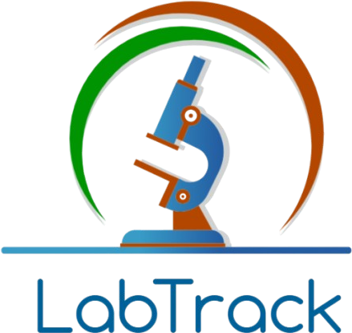
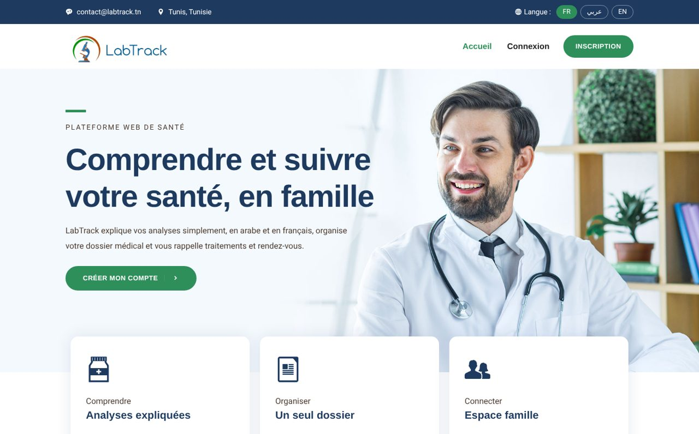
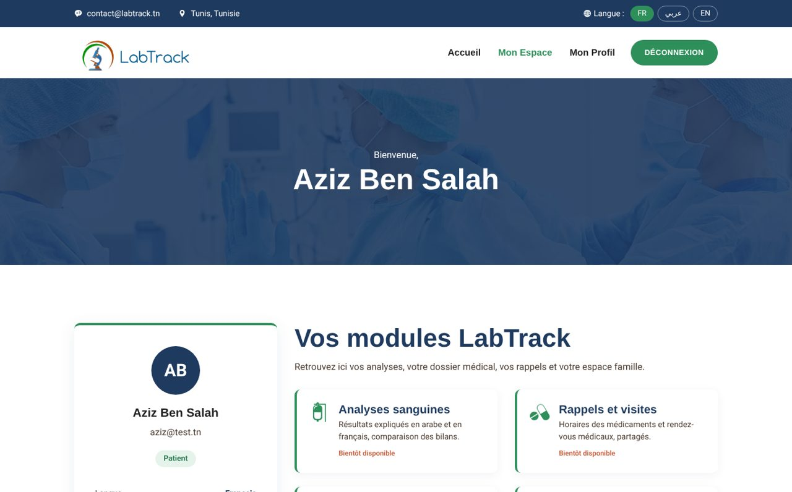
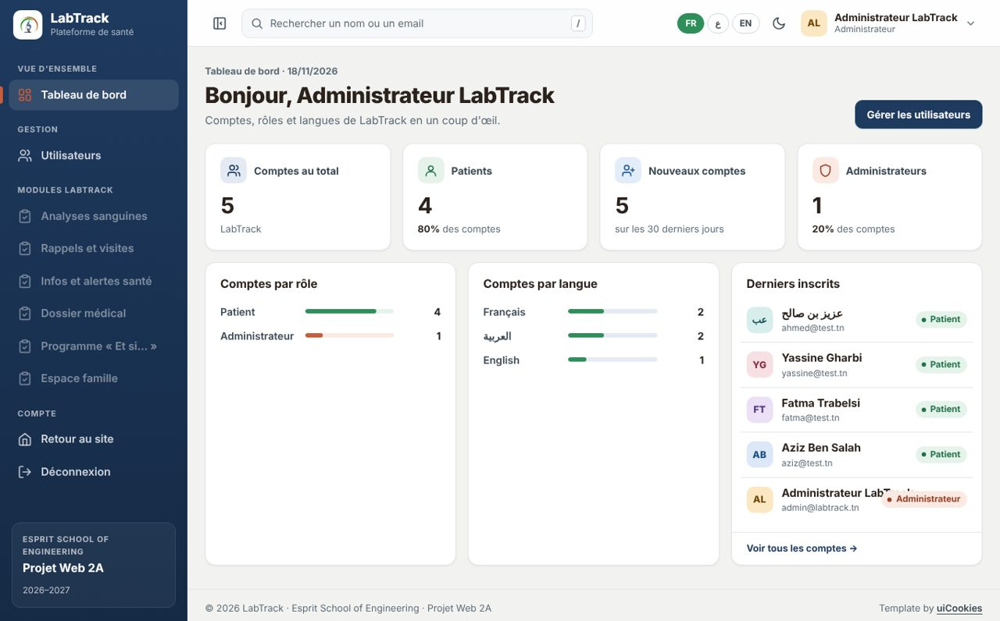
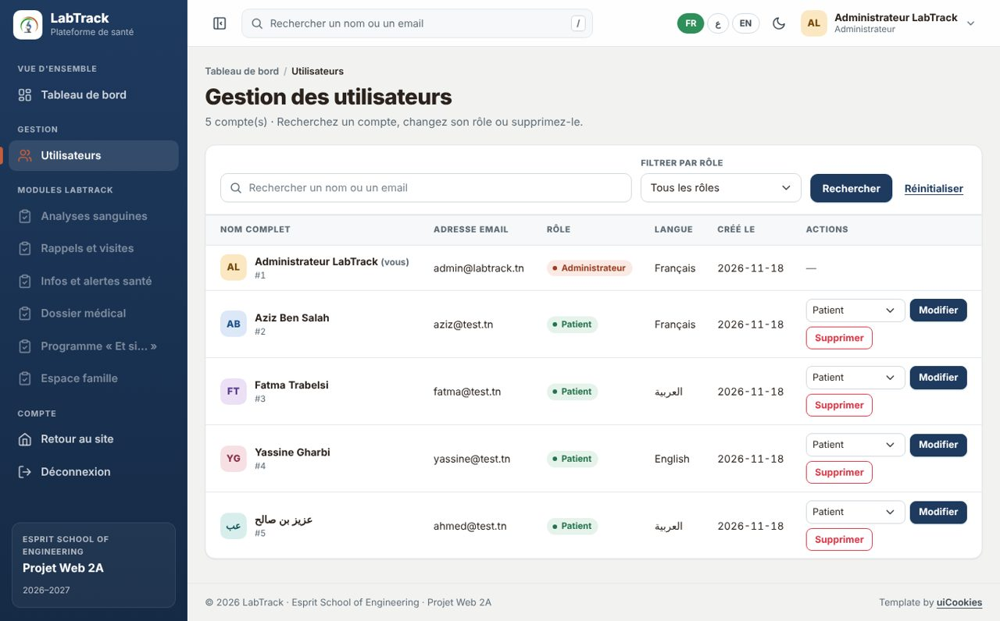
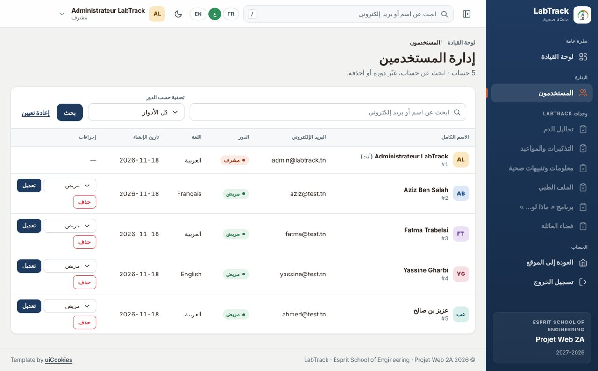
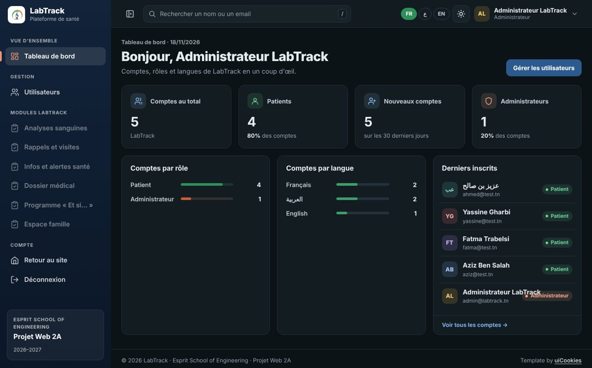

<p align="center"></p>

# LabTrack – Web Health Platform

**LabTrack** is a web health platform that helps citizens, in Tunisia in particular, **understand, organise, verify, anticipate and share** their health, on their own and with their family. It explains blood test results in plain Arabic and French, keeps a single medical record, reminds patients of treatments and appointments, and lets families follow their loved ones with consent.

> LabTrack supports, the doctor decides: the platform never gives a diagnosis.



## Table of Contents

- [Overview](#overview)
- [Features](#features)
- [Tech Stack](#tech-stack)
- [Architecture](#architecture)
- [Getting Started](#getting-started)
- [Usage](#usage)
- [Screenshots](#screenshots)
- [Contributors](#contributors)
- [Academic Context](#academic-context)
- [Acknowledgments](#acknowledgments)
- [License](#license)

## Overview

This project was developed as part of the **Web Technologies Project (Projet Web) – 2nd Year Engineering Program at Esprit School of Engineering** (Academic Year 2026–2027).

**The problem.** Blood test reports are full of technical terms, treatments and appointments get forgotten, health misinformation spreads on social networks, medical documents are scattered between paper, photos and memory, and each family member is followed separately.

**The answer.** LabTrack brings six health features together in one bilingual platform (Arabic, French, plus English), adapted to the Tunisian context: local laboratory units, available medicines and CNAM.

## Features

| # | Module | Description | Status |
|---|---|---|---|
| — | **User management** | Accounts, roles (patient, admin), preferred language, profile, admin back office | ✅ Done |
| 1 | Blood tests | Results explained simply in Arabic and French, comparison of two reports, questions to ask the doctor | 🚧 In progress |
| 2 | Reminders & visits | Medication schedules and medical appointments, shared with the family | 🚧 In progress |
| 3 | Health news & alerts | Reliable articles (WHO, Ministry of Health), favourites, alerts (campaigns, screening) | 🚧 In progress |
| 4 | Medical record | Symptoms, dates, medicines, sleep, food, sport, clear report for the doctor | 🚧 In progress |
| 5 | "What if…" program | Lifestyle scenarios ("I continue" vs "I change") and a personalised plan, without alarmism | 🚧 In progress |
| 6 | Family space | Profiles for parents, children and elders, access by consent, messages | 🚧 In progress |

**User management module in detail**

- Sign up, log in, log out, with sessions that expire after 30 minutes of inactivity
- **One login at a time**: signing in again (another browser or device) closes the previous session
- One account per email (an email can be reused only after its account is deleted), and a unique **4-digit personal code** (e.g. `#0427`) visible only to the account owner
- Two roles: **patient** (front office) and **admin** (back office). Public sign-up always creates a patient: only an admin can grant the admin role.
- Interface in **Arabic (right-to-left), French and English**, chosen at sign-up, switchable on every page and saved in the user's profile
- Forgot password: "Forgot your password?" on the login page sends a 6-digit code by email. It is valid for **5 minutes**, works only once, is stored hashed, and is cancelled after 5 wrong tries. To send real emails, copy `config/mail.example.php` to `config/mail.local.php` (Gmail app password); without it, emails are saved as `.eml` files in `storage/mails/`
- Profile page: change name, language and password, and a **profile picture** like on social networks: click the round photo, pick an image and it is saved at once (JPG, PNG or WebP, 2 MB max). The real file type is checked on the server, the file gets a random name and is stored in `storage/avatars/`, which cannot be opened directly: it is shown through `index.php?page=avatar` to every logged-in member (patient pages, admin user list, dashboard and top bar)
- Admin back office: statistics and full user **CRUD** — add an account (with its role and language), view an account's details, edit it (name, email, role, language, new password), delete it — plus search and filter by role
- Input validation on every form: in **PHP** on the server (always) and in **JavaScript** in the browser (`assets/js/form-validation.js`, messages in the current language)
- Security: prepared statements (SQL injection), `password_hash()` / bcrypt, output escaping and Content-Security-Policy (XSS), CSRF tokens on every form, `session_regenerate_id()`, HttpOnly/SameSite cookies, role check on every protected page

## Tech Stack

### Frontend

- HTML5, CSS3, JavaScript
- **Front office:** [Novena](https://github.com/themefisher/novena) medical template (Bootstrap 4, jQuery, IcoFont)
- **Back office:** [Registrar](https://uicookies.com/) admin template (Bootstrap 5.3, vanilla JavaScript, light/dark mode)

### Backend

- **PHP 8** (no framework), MVC architecture
- **MySQL** with PDO
- Apache (XAMPP / WAMP)

## Architecture

The project follows the **MVC** pattern with a single entry point and a routing table. Shared page parts are written once and included everywhere (template integration workshop):

- **Front office:** each page assembles `views/front/includes/` (head, spinner, navbar, footer, scripts) with `require_once`. The navbar highlights the current page with `navActive()`.
- **Back office:** each controller calls `render()` from the base `Controller`. The page content is captured in `$content` and placed in `views/back/layout.php`, which assembles `views/back/partials/` (head, sidebar, header, footer, scripts). The sidebar highlights the current page with `isActive()`.

```
LabTrack/
├── index.php                  Single entry point: session security, HTTP headers, routing
├── config/
│   ├── database.php           PDO connection (Singleton)
│   ├── routes.php             ?page=key  =>  [Controller, method]
│   └── lang/                  Interface texts: fr.php, ar.php, en.php
├── controllers/
│   ├── Controller.php         Base controller: render() (back office), renderFront() (front office)
│   ├── AuthController.php     Accounts, sessions, roles, language, CSRF (all business logic)
│   └── AdminController.php    Back office pages (admin role only)
├── models/
│   └── UserModel.php          User entity: private attributes + getters/setters
├── views/
│   ├── helpers.php            e(), navActive(), isActive(), initials()
│   ├── front/                 Front office (Novena)
│   │   ├── includes/          head, spinner, navbar, footer, scripts
│   │   └── home, login, register, user_space, profile
│   └── back/                  Back office (Registrar)
│       ├── layout.php         Assembles the partials around $content
│       ├── partials/          head, sidebar, header, footer, scripts
│       └── pages/             dashboard, users, users_scripts
├── assets/
│   ├── front/                 Novena CSS/JS/plugins/images + labtrack.css / labtrack.js
│   └── back/                  Registrar CSS/JS + labtrack.css, admin.js, users.js
├── docs/                      Screenshots and security workshop notes
├── database.sql               Database, users table and test admin account
└── LICENSE
```

**Database (central table).** Every other LabTrack table (record, blood test, medicine, appointment, simulation, family space…) references `utilisateur` through a `user_id` foreign key.

| Column | Type |
|---|---|
| `id` | INT, primary key |
| `nom` | VARCHAR(100) |
| `email` | VARCHAR(150), unique |
| `password` | VARCHAR(255), bcrypt hash |
| `role` | ENUM('patient', 'admin') |
| `langue` | ENUM('fr', 'ar', 'en') |
| `avatar` | VARCHAR(64), profile picture file name (NULL = initials) |
| `created_at` | TIMESTAMP |

`password_reset` (forgot password): `user_id` (foreign key), `code_hash` (the 6-digit code, hashed), `expires_at` (sending time + 5 minutes), `attempts` (wrong codes, max 5). Created automatically the first time it is used.

## Getting Started

### Prerequisites

- [XAMPP](https://www.apachefriends.org/) or [WAMP](https://www.wampserver.com/) (PHP 8.0 or later, MySQL, Apache)
- Git

### Installation

1. Clone the repository:

   ```bash
   git clone https://github.com/ahmedsouissi2005-beep/Esprit-PW-2A13-2027-LabTrack.git
   cd Esprit-PW-2A13-2027-LabTrack
   ```

2. Put the project in your web server folder:
   * `htdocs` (XAMPP) or `www` (WAMP)
   * Start **Apache** and **MySQL** from the XAMPP/WAMP control panel.

3. Create the database:
   * Open `http://localhost/phpmyadmin`
   * Go to the **SQL** tab (or **Import**) and run `database.sql`.
   * This creates the `labtrack` database, the `utilisateur` table and a test admin account.

4. If needed, edit the MySQL user and password in `config/database.php`.

5. Open the project in your browser:

   ```
   http://localhost/Esprit-PW-2A13-2027-LabTrack/index.php
   ```

> **How the module was built:** `main` started with the documentation and the template assets only.
> Each member brought their part on their own branch through a Pull Request (all merged).
> Ismail, Fadi and Yassine merged into `feature/security-sessions`, which was merged into `main` last.
>
> | Branch | Member | Pull Request | Brings |
> |---|---|---|---|
> | `feature/security-sessions` | Ahmed | #1 | `index.php`, routes, base controller, `AdminController`, `AuthController` (sessions, CSRF, roles, brute force, admin CRUD), layouts and partials, `docs/SECURITE.md` |
> | `feature/user-database` | Aziz | #5 | `database.sql`, `config/database.php`, `models/UserModel.php` |
> | `feature/user-auth` | Ismail | #6 | login and register pages, `loginPage` / `registerPage` / `register` / `logoutAction` |
> | `feature/user-profile` | Fadi | #7 | profile and patient space pages, `dashboard` / `profile` / `updateProfile` / `changePassword` |
> | `feature/user-backoffice` | Fatma | #2 | back office pages (`users`, `user_form`, `dashboard`), their scripts, `assets/back/js/users.js` |
> | `feature/user-validation` | Yassine | #3 | `form-validation.js`, `validationAttrs()`, `isValidNom` / `validateAccountFields`, `config/lang/` |

## Usage

**Test admin account:** `admin@labtrack.tn` / `Admin@1234`

| URL (`index.php?page=…`) | Access | What it does |
|---|---|---|
| `home` | Everyone | Public home page |
| `register`, `login` | Visitors | Create an account (patient role), log in |
| `forgot_password`, `reset_password` | Visitors | Forgot password: get a 6-digit code by email, valid for **5 minutes** and 5 tries, then choose a new password |
| `dashboard` | Logged-in users | Personal space of the patient |
| `profile` | Logged-in users | Change profile picture, name, language, password |
| `avatar` | Logged-in users | Profile picture of any account (`&id=`), visible to every logged-in member |
| `admin` | Admin only | Back office dashboard |
| `admin_users` | Admin only | Search accounts, change a role, delete an account |

**For the other team members (adding a module):**

1. Create your table with `user_id INT NOT NULL, FOREIGN KEY (user_id) REFERENCES utilisateur(id) ON DELETE CASCADE`.
2. Create your controller (extends `Controller`), your views, then add your route in `config/routes.php`.
3. Protect your pages with `AuthController::requireAuth();` or `AuthController::requireRole('admin');` (back office).
4. Use `$_SESSION['user_id']`, `$_SESSION['role']` and `$_SESSION['langue']` for the logged-in user.
5. Add your texts to `config/lang/fr.php`, `ar.php` and `en.php`, then display `$t['your_key']` in your views.
6. Add your link in `views/front/includes/navbar.php` and/or `views/back/partials/sidebar.php`.

## Screenshots

| Patient space | Admin dashboard |
|---|---|
|  |  |
| **User management** | **User management in Arabic (RTL)** |
|  |  |
| **Dark mode** | |
|  | |

## Contributors

**User management module: who did what**

| Member | Part of the user management module | GitHub |
|---|---|---|
| Ahmed | Security & sessions, roles & access control, admin CRUD logic, repository and reviews | [@ahmedsouissi2005-beep](https://github.com/ahmedsouissi2005-beep) |
| Aziz | Database & model | [@marouaniaziz08-byte](https://github.com/marouaniaziz08-byte) |
| Ismail | Register, login, logout pages | [@notisma](https://github.com/notisma) |
| Fadi | Profile & patient space | [@charrifedi](https://github.com/charrifedi) |
| Fatma | Back office pages | [@bouattourfatma12-debug](https://github.com/bouattourfatma12-debug) |
| Yassine | Validation & translations | [@idc01-ux](https://github.com/idc01-ux) |

**LabTrack modules (next steps)**

| Member | Module |
|---|---|
| Aziz | Reminders & visits |
| Ismail | Blood tests |
| Fadi | Health news & alerts |
| Fatma | Medical record |
| Yassine | "What if…" program |
| Ahmed | Family space |

### How to contribute

1. **Fork** the project (or create a branch if you are a team member).
2. Create a branch for your feature:

   ```bash
   git checkout -b feature/module-name
   ```

3. Commit your changes:

   ```bash
   git add .
   git commit -m "Add: short description of the change"
   ```

4. Push the branch:

   ```bash
   git push origin feature/module-name
   ```

5. Open a **Pull Request** on GitHub and describe what you changed.

## Academic Context

Developed at **Esprit School of Engineering – Tunisia**
Web Technologies Project (Projet Web) – Class 2A13 | Academic Year 2026–2027

Targeted UN Sustainable Development Goals: **SDG 3** Good health and well-being (3.4, 3.8, 3.d), SDG 9.c, SDG 10.2, SDG 16.10, SDG 17.17.

## Acknowledgments

- **Esprit School of Engineering** and the Web Technologies Project teaching team for their workshops (sessions and security, template integration, README and GitHub standards).
- [Themefisher](https://themefisher.com/) for the **Novena** template (MIT License), used for the front office.
- [uiCookies](https://uicookies.com/) for the **Registrar** template (free for personal and commercial use), used for the back office.
- Template photos: see `assets/back/README-registrar.txt` and the Novena repository.

## License

This project is licensed under the **MIT License**. See the [LICENSE](./LICENSE) file for details.

The MIT License lets anyone use, copy, modify and redistribute the code, including for commercial purposes, as long as the copyright notice and the license text are kept. The software is provided "as is", without warranty. The third-party templates keep their own licenses (Novena: MIT, see `assets/front/LICENSE-novena.txt`; Registrar: see `assets/back/README-registrar.txt`).
